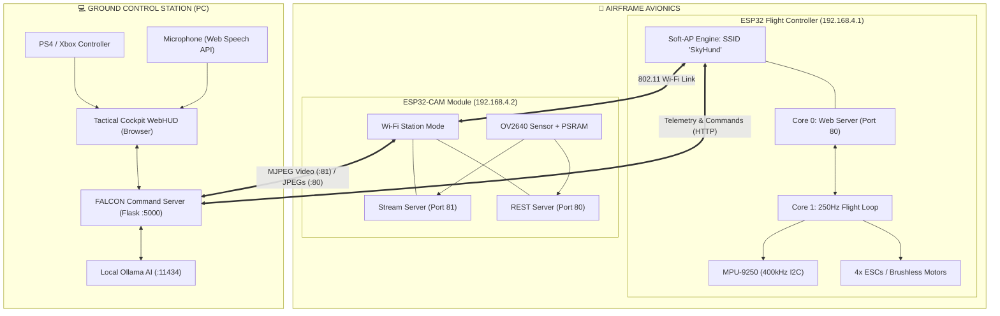
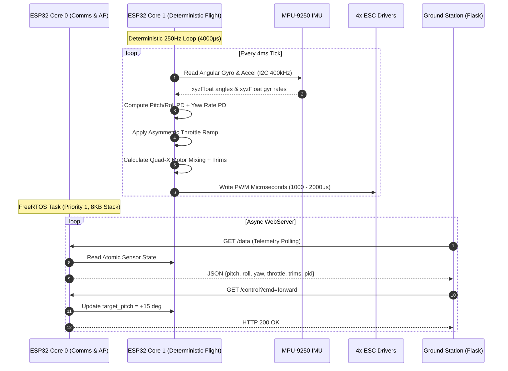
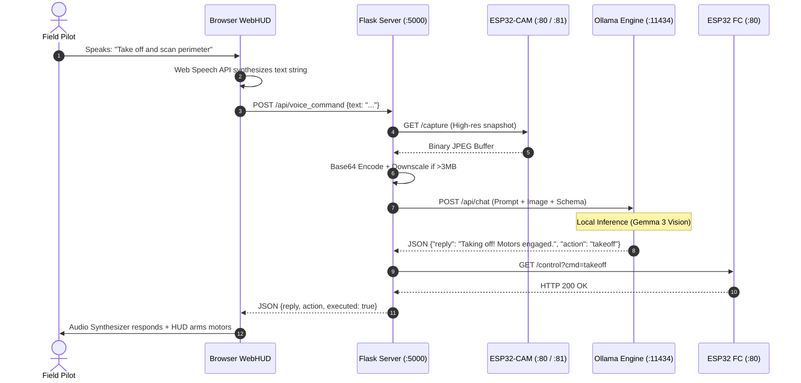

<p align="center">
  
</p>

<p align="center">
  <a href="https://espressif.com"></a>
  <a href="https://espressif.com"></a>
  <a href="https://freertos.org"></a>
  <a href="https://www.python.org"></a>
  <a href="https://ollama.ai"></a>
  <a href="https://developer.mozilla.org"></a>
  <a href="LICENSE"></a>
</p>

<p align="center">
  <b>SkyHound</b> (Codename <b>FALCON</b>) is a high-performance, fully integrated open-source UAV flight avionics and command ecosystem. Built around a dual-core <b>ESP32</b> executing a deterministic <b>250 Hz (4 ms)</b> PD stabilization loop on bare-metal FreeRTOS, a dedicated <b>ESP32-CAM</b> wireless video streaming module, and an on-premise <b>Python Flask & Ollama Edge-AI Ground Station</b> featuring real-time scene recognition, tactical speech flight control, and an HTML5 Canvas telemetry oscilloscope.
</p>

---

## 📑 Table of Contents

- [⚡ System Overview & Innovations](#-system-overview--innovations)
- [🏛️ Architectural Topography](#️-architectural-topography)
  - [1. Network & Communications Topology](#1-network--communications-topology)
  - [2. Dual-Core FreeRTOS Threading Model](#2-dual-core-freertos-threading-model)
  - [3. Edge-AI Vision & Tactical Voice Pipeline](#3-edge-ai-vision--tactical-voice-pipeline)
- [🔩 Hardware Bill of Materials (BOM)](#-hardware-bill-of-materials-bom)
- [🔌 Pinout Matrix & Quad-X Aerodynamics](#-pinout-matrix--quad-x-aerodynamics)
  - [ESP32 Flight Controller Pinout](#esp32-flight-controller-pinout)
  - [ESP32-CAM Sensor Pinout](#esp32-cam-sensor-pinout)
  - [Quad-X Motor Dynamics & Thrust Formulation](#quad-x-motor-dynamics--thrust-formulation)
- [🎛️ Flight Dynamics & Control Theory](#️-flight-dynamics--control-theory)
  - [Deterministic 250 Hz Loop Timing](#deterministic-250-hz-loop-timing)
  - [Dual-Axis PD Attitude Stabilization](#dual-axis-pd-attitude-stabilization)
  - [Gyro-Rate Yaw Damping Loop](#gyro-rate-yaw-damping-loop)
  - [Asymmetric Throttle Acceleration Profiling](#asymmetric-throttle-acceleration-profiling)
  - [4-Tier Double-Tap Velocity Gearing](#4-tier-double-tap-velocity-gearing)
- [👁️ Tactical Edge-AI Subsystem (GEO)](#️-tactical-edge-ai-subsystem-geo)
  - [Dual HTTP Streaming & Snapshot Server](#dual-http-streaming--snapshot-server)
  - [On-Premise Ollama Vision Inference](#on-premise-ollama-vision-inference)
  - [Bilingual Voice NLP & Function Calling](#bilingual-voice-nlp--function-calling)
- [🕹️ FALCON Ground Station Command Cockpit](#️-falcon-ground-station-command-cockpit)
  - [Cyberpunk HUD & Artificial Horizon](#cyberpunk-hud--artificial-horizon)
  - [Real-Time HTML5 Telemetry Oscilloscope](#real-time-html5-telemetry-oscilloscope)
  - [DualShock 4 / Xbox Gamepad Integration](#dualshock-4--xbox-gamepad-integration)
  - [Live Flight Tuning & Trim Panel](#live-flight-tuning--trim-panel)
  - [In-Browser WebM Mission Recorder](#in-browser-webm-mission-recorder)
- [📡 Exhaustive API Specification](#-exhaustive-api-specification)
- [🚀 Quickstart & Deployment Guide](#-quickstart--deployment-guide)
  - [1. Flashing the ESP32 Flight Controller](#1-flashing-the-esp32-flight-controller)
  - [2. Flashing the ESP32-CAM via `upload.bat`](#2-flashing-the-esp32-cam-via-uploadbat)
  - [3. Launching Ground Station via `run_server.bat`](#3-launching-ground-station-via-run_serverbat)
  - [4. Bench Testing & Pre-Flight Calibration](#4-bench-testing--pre-flight-calibration)
- [⚠️ Safety Protocols & Failsafes](#️-safety-protocols--failsafes)
- [📂 Repository Directory Structure](#-repository-directory-structure)
- [📄 License & Authorship](#-license--authorship)

---

## ⚡ System Overview & Innovations

```
                       ┌──────────────────────────────────────────────┐
                       │           SKYHOUND COMMAND ECOSYSTEM         │
                       └──────────────────────┬───────────────────────┘
                                              │
                 ┌────────────────────────────┼────────────────────────────┐
                 │                            │                            │
                 ▼                            ▼                            ▼
      ┌─────────────────────┐      ┌─────────────────────┐      ┌─────────────────────┐
      │  ESP32 FLIGHT CORE  │      │   ESP32-CAM VISION  │      │  GROUND STATION AI  │
      │ • FreeRTOS Core 0/1 │      │ • Port 81 MJPEG 30fps│     │ • Python Flask 3.12 │
      │ • 250Hz Determinism │      │ • Port 80 JPEG Snap │      │ • Ollama Vision LLM │
      │ • Gyro-Rate Yaw PD  │      │ • PSRAM Dual-Buffer │      │ • Web Gamepad API   │
      │ • Asymmetric Ramp   │      │ • Auto-Reconnection │      │ • Web Speech Voice  │
      └─────────────────────┘      └─────────────────────┘      └─────────────────────┘
```

SkyHound abandons conventional hobbyist multirotor limitations in favor of an integrated, dual-microcontroller architecture that segregates critical real-time flight telemetry from high-bandwidth video encoding and neural computation:

* **Dual-Core FreeRTOS Asymmetric Multi-Processing (AMP):** The flight controller dedicates **Core 1** entirely to an uninterrupted 250 Hz (4 ms) sensor-acquisition and motor-mixing loop, while **Core 0** independently manages the Wi-Fi AP stack and asynchronous WebServer. Network traffic cannot starve the flight stabilization routine.
* **Fast-Mode I2C at 400 kHz:** The MPU-9250 9-DoF IMU communicates over a 400 kHz bus, slashing raw inertial readout latency to under $1.2\text{ ms}$ and leaving sufficient processing headroom for deadband filtering and real-time PD derivatives.
* **Gyro-Rate Angular Yaw Stabilization:** Unlike naive drones that stabilize yaw by integrating absolute orientation (which drifts over time due to magnetic perturbations and gyro integration error), SkyHound stabilizes yaw velocity ($\omega_z$ in $^\circ/\text{s}$) directly using raw gyro rates.
* **Edge-AI Tactical Vision (Project GEO):** Leverages local Ollama neural models (`gemma3`, `gemma2:2b`, `llava`) without cloud connectivity. High-resolution captures from the ESP32-CAM are transmitted into local RAM, evaluated for tactical scene reconnaissance, and parsed into situational descriptions in English or Egyptian Arabic.
* **Acoustic Function Calling:** Spoken orders issued to the ground station microphone (`"take off"`, `"turn right"`, `"speed 3"`, `"emergency stop"`) are interpreted by the local language model, converted to structured JSON actuation objects, and dispatched over HTTP to the flight controller in milliseconds.
* **Sub-50ms Telemetry Oscilloscope:** An interactive HTML5 Canvas continuously renders raw real-time Pitch, Roll, and Throttle waveforms directly inside the cockpit dashboard, accompanied by tilt danger thresholds ($>20^\circ$) and in-flight motor trim controls.

---

## 🏛️ Architectural Topography

### 1. Network & Communications Topology

The entire SkyHound fleet operates as an autonomous micro-mesh network centered around an isolated, self-hosted 802.11b/g/n Access Point:



---

### 2. Dual-Core FreeRTOS Threading Model



---

### 3. Edge-AI Vision & Tactical Voice Pipeline



---

## 🔩 Hardware Bill of Materials (BOM)

| Subsystem | Component | Specifications | Operating Voltage | Protocol / Interface | Purpose & Redundancy |
| :--- | :--- | :--- | :--- | :--- | :--- |
| **Main Flight Computer** | ESP32-WROOM-32 / NodeMCU | Dual-Core Tensilica Xtensa 32-bit LX6 @ 240 MHz, 520 KB SRAM, 4 MB SPI Flash | 5.0 V (Vin) / 3.3 V Logic | 802.11 b/g/n Soft-AP, PWM, I2C | Executes 250 Hz real-time flight dynamics, failsafe watchdog, and command parsing |
| **Vision & AI Module** | AI-Thinker ESP32-CAM | OV2640 2 Megapixel CMOS Sensor, 4 MB External PSRAM, Onboard High-Power Flash LED | 5.0 V / 2A clean rail | DVP 8-bit Parallel, I2C (SCCB), 802.11 STA | High-framerate MJPEG wireless stream & on-demand high-definition snapshot capture |
| **Inertial Measurement** | MPU-9250 | 3-Axis Gyro ($\pm 2000^\circ/\text{s}$), 3-Axis Accel ($\pm 16g$), AK8963 Magnetometer | 3.3 V | Fast-Mode I2C @ 400 kHz (`0x68`) | Attitude estimation, tilt detection, and rate-based angular stabilization |
| **Motor Drivers (ESCs)** | 4x SimonK / BLHeli ESC | 30A Continuous Current, 40A Burst, Linear 5V/2A BEC, 500 Hz PWM update rate | 2S – 4S LiPo (7.4V – 14.8V) | Standard Servo PWM (1000–2000 $\mu\text{s}$) | Electronic speed control for 4 brushless motors with optocoupled grounds |
| **Propulsion Motors** | 4x A2212 Outrunner Motors | 920KV or 1000KV, Max Thrust $\approx 850\text{g}$ per motor (Total $>3.4\text{kg}$) | 3S LiPo (11.1V nominal) | 3-Phase Brushless AC | 2x Clockwise (CW) + 2x Counter-Clockwise (CCW) rotation |
| **Propellers** | 4x 1045 Multi-Rotor Props | 10-inch diameter, 4.5-inch pitch (2x CW + 2x CCW) | N/A | Direct Motor Shaft Lock | Generates vertical lift and aerodynamic rotational yaw torque |
| **Power Distribution** | Matek PDB with Dual BEC | Built-in 5V/3A and 12V/2A filtered switching regulators, 100A current rating | 3S – 6S Input | Copper Bus Traces | Cleans high-frequency motor inductive spikes; supplies isolated 5V to microcontrollers |
| **Main Battery** | 3S LiPo Battery Pack | 11.1V, 2200–3000 mAh, 35C–70C continuous discharge rating | 11.1V – 12.6V | XT60 Connector | Main power plant delivering up to 70A burst flight current |
| **Ground Station PC** | Laptop / Workstation | Intel Core i5/i7 or Apple Silicon / AMD Ryzen, 16GB RAM, Dedicated GPU optional | 100-240V AC | Wi-Fi 802.11n + USB Gamepad | Runs Flask GCS server and local Ollama model (`gemma3`) |

---

## 🔌 Pinout Matrix & Quad-X Aerodynamics

### ESP32 Flight Controller Pinout

> [!IMPORTANT]
> The ESC signal ground wires **must** be tied directly to the ESP32 ground plane to eliminate PWM signal distortion caused by heavy brushless motor ground bounce.

```
                     ┌───────────────────────┐
                     │   ESP32 FLIGHT CORE   │
                     │                       │
     ESC 1 (FL) ◄────┤ GPIO 13       GPIO 21 ├────► MPU-9250 SDA (I2C)
     ESC 3 (BL) ◄────┤ GPIO 14       GPIO 22 ├────► MPU-9250 SCL (I2C)
     ESC 4 (BR) ◄────┤ GPIO 27       GPIO 32 ├────► ESC 2 (FR)
                     │                       │
         UBEC 5V ────┤ VIN               GND ├──── Common Ground
                     └───────────────────────┘
```

| Physical Device | Pin Type | ESP32 GPIO | Description / Configuration |
| :--- | :--- | :--- | :--- |
| **MPU-9250 SDA** | I2C Data | `GPIO 21` | Hardware I2C bidirectional data, 4.7kΩ pull-up |
| **MPU-9250 SCL** | I2C Clock | `GPIO 22` | Hardware I2C clock (driven at 400,000 Hz) |
| **ESC 1 (Front-Left, M1)** | PWM Output | `GPIO 13` | Motor 1 Servo pulse width (1000–2000 $\mu\text{s}$) |
| **ESC 2 (Front-Right, M2)**| PWM Output | `GPIO 32` | Motor 2 Servo pulse width (1000–2000 $\mu\text{s}$) |
| **ESC 3 (Back-Left, M3)**  | PWM Output | `GPIO 14` | Motor 3 Servo pulse width (1000–2000 $\mu\text{s}$) |
| **ESC 4 (Back-Right, M4)** | PWM Output | `GPIO 27` | Motor 4 Servo pulse width (1000–2000 $\mu\text{s}$) |
| **System Power Input** | Power In | `VIN` | Clean 5.0V regulated DC from UBEC |
| **Common Ground** | Ground | `GND` | Tied to PDB, MPU-9250 ground, and ESC signal grounds |

---

### ESP32-CAM Sensor Pinout

The AI-Thinker ESP32-CAM module utilizes internal high-speed buses to route the OV2640 DVP sensor without interfering with the flash LED:

| Signal Name | ESP32-CAM Pin | Signal Name | ESP32-CAM Pin |
| :--- | :--- | :--- | :--- |
| **Camera Power Down (PWDN)** | `GPIO 32` | **Data Bit 0 (Y2)** | `GPIO 5` |
| **External Clock (XCLK)** | `GPIO 0` (20 MHz) | **Data Bit 1 (Y3)** | `GPIO 18` |
| **Pixel Clock (PCLK)** | `GPIO 22` | **Data Bit 2 (Y4)** | `GPIO 19` |
| **Vertical Sync (VSYNC)** | `GPIO 25` | **Data Bit 3 (Y5)** | `GPIO 21` |
| **Horizontal Reference (HREF)** | `GPIO 23` | **Data Bit 4 (Y6)** | `GPIO 36` |
| **SCCB Serial Data (SIOD)** | `GPIO 26` | **Data Bit 5 (Y7)** | `GPIO 39` |
| **SCCB Serial Clock (SIOC)** | `GPIO 27` | **Data Bit 6 (Y8)** | `GPIO 34` |
| **Ultra-Bright Flash LED** | `GPIO 4` | **Data Bit 7 (Y9)** | `GPIO 35` |

---

### Quad-X Motor Dynamics & Thrust Formulation

SkyHound implements a symmetrical Quad-X aerodynamic airframe geometry. Motors are configured in opposing counter-rotating pairs to balance rotational torque:

```
                            ▲ FORWARD (Pitch +)
                            │
               M1 (FL) ⟲         ⟳ M2 (FR)
             [GPIO 13]             [GPIO 32]
             (CCW: +Yaw)           (CW: -Yaw)
                      \           /
                       \         /
                        \  [X]  /  <─── Flight Controller & IMU
                        /         \
                       /           \
                      /             \
             [GPIO 14]             [GPIO 27]
             (CW: -Yaw)            (CCW: +Yaw)
               M3 (BL) ⟳         ⟲ M4 (BR)
                            │
                            ▼ BACKWARD (Pitch -)
```

The mathematical motor mixing matrix maps the current throttle, pitch error corrections, roll error corrections, rate-derived yaw corrections, and individual motor trims to each physical ESC:

$$\begin{aligned}
M_1 \,(\text{Front-Left, CCW}) &= \operatorname{constrain}\Big(T_{\text{curr}} - P_{\text{corr}} + R_{\text{corr}} + Y_{\text{corr}} + \text{Trim}_1,\, 1000,\, 2000\Big) \\
M_2 \,(\text{Front-Right, CW}) &= \operatorname{constrain}\Big(T_{\text{curr}} - P_{\text{corr}} - R_{\text{corr}} - Y_{\text{corr}} + \text{Trim}_2,\, 1000,\, 2000\Big) \\
M_3 \,(\text{Back-Left, CW})   &= \operatorname{constrain}\Big(T_{\text{curr}} + P_{\text{corr}} + R_{\text{corr}} - Y_{\text{corr}} + \text{Trim}_3,\, 1000,\, 2000\Big) \\
M_4 \,(\text{Back-Right, CCW}) &= \operatorname{constrain}\Big(T_{\text{curr}} + P_{\text{corr}} - R_{\text{corr}} + Y_{\text{corr}} + \text{Trim}_4,\, 1000,\, 2000\Big)
\end{aligned}$$

Where:
* $T_{\text{curr}}$ is the active asymmetric throttle value ($1000 \le T_{\text{curr}} \le 2000\,\mu\text{s}$).
* $P_{\text{corr}}$ is the pitch stabilization correction.
* $R_{\text{corr}}$ is the roll stabilization correction.
* $Y_{\text{corr}}$ is the angular yaw rate stabilization correction.
* $\text{Trim}_n$ is the persistent motor trim offset ($\pm 5\,\mu\text{s}$ per step) calibrated via the HUD settings panel.

---

## 🎛️ Flight Dynamics & Control Theory

### Deterministic 250 Hz Loop Timing

Real-time firmware stability demands hard determinism. The flight loop on Core 1 enforces an exact 4000 microsecond cycle ($f = 250\text{ Hz}$):

```cpp
unsigned long now = micros();
if (now - loop_timer < 4000) {
    return; // Wait for exact 4ms milestone without blocking FreeRTOS scheduler
}
float dt = (now - loop_timer) / 1000000.0f; // Calculate exact elapsed dt in seconds
loop_timer = now;
```

This guarantees that all numerical time-derivatives ($dE/dt$) remain mathematically rigorous, immune to the latency spikes commonly caused by Wi-Fi transmissions on single-core platforms.

---

### Dual-Axis PD Attitude Stabilization

Pitch and Roll are stabilized using a proportional-derivative (PD) controller operating against calibrated Euler angles:

$$e_{\text{pitch}} = \theta_{\text{sensor}} - \theta_{\text{target}}, \quad e_{\text{roll}} = -(\phi_{\text{sensor}} - \phi_{\text{target}})$$

To prevent micro-vibrations and actuator chatter around equilibrium, a hardware-calibrated deadband threshold ($\pm 0.5^\circ$) zeroes out negligible sensor noise:

$$\text{if } (|e| < 0.5^\circ) \implies e = 0, \quad \frac{de}{dt} = 0$$

The derivative terms predict future trajectory and actively oppose rotational inertia:

$$\frac{de_{\text{pitch}}}{dt} = \frac{e_{\text{pitch}} - e_{\text{pitch, prev}}}{dt}, \quad \frac{de_{\text{roll}}}{dt} = \frac{e_{\text{roll}} - e_{\text{roll, prev}}}{dt}$$

$$P_{\text{corr}} = (e_{\text{pitch}} \cdot K_p) + \left(\frac{de_{\text{pitch}}}{dt} \cdot K_d\right)$$
$$R_{\text{corr}} = (e_{\text{roll}} \cdot K_p) + \left(\frac{de_{\text{roll}}}{dt} \cdot K_d\right)$$

*Default Gains:* $K_p = 0.8$, $K_d = 0.005$ (Tunable on-the-fly via web telemetry).

---

### Gyro-Rate Yaw Damping Loop

A major challenge in quadrotor engineering is yaw drift: integrating magnetometer or accelerometer vectors during high motor magnetic interference creates false headings. 

SkyHound eliminates yaw drift by stabilizing **angular rotation rate** rather than raw angle:

```cpp
float yaw_rate = gyr.z;                        // Raw Z-axis rotation speed in °/s
float yaw_rate_error = yaw_rate - target_yaw;  // target_yaw = 0 for steady heading
if (abs(yaw_rate_error) < 2.0) { yaw_rate_error = 0; d_yaw = 0; }
float yawCorr = (yaw_rate_error * Kp_yaw) + (d_yaw * Kd_yaw);
```

*Default Yaw Gains:* $K_{p,\text{yaw}} = 1.5$, $K_{d,\text{yaw}} = 0.01$, with a deadband threshold of $\pm 2.0^\circ/\text{s}$.

---

### Asymmetric Throttle Acceleration Profiling

Abrupt throttle surges cause violent flips and severe battery voltage drop, while sluggish deceleration impairs landing control. SkyHound solves this with an asymmetric ramp algorithm:

```
Ascending Ramp (+1µs / 12ms)            Descending Ramp (-5µs / 4ms)
       ▲                                       │
       │     Smooth Takeoff                    │  Emergency Descent
       │      & Gentle Hover                   │  & Rapid Land
───────┴─────────────────────────────► ────────┴─────────────────────────────►
```

* **Ascent (Ramp-Up):** Increases $+1\,\mu\text{s}$ every 3 loop cycles ($\approx 12\text{ ms}$). Eliminates sudden jerk and protects the ESC FETs.
* **Descent (Ramp-Down):** Decreases $-5\,\mu\text{s}$ every single cycle ($\approx 4\text{ ms}$). Decelerates over 15x faster for emergency landing and obstacle evasion.

---

### 4-Tier Double-Tap Velocity Gearing

SkyHound features an innovative double-tap speed system allowing the pilot to select progressive speed modes with dual throttle ceilings:

| Gear Level | Command | Single Tap (80% Cruise) | Double Tap (100% Full Speed) | Flight Profile |
| :---: | :---: | :---: | :---: | :--- |
| **Level 1** | `speed1` | $1160\,\mu\text{s}$ | $1200\,\mu\text{s}$ | Indoor inspection, gentle hover, novice flight |
| **Level 2** | `speed2` | $1280\,\mu\text{s}$ | $1350\,\mu\text{s}$ | Outdoor calm flight, smooth video filming |
| **Level 3** | `speed3` | $1400\,\mu\text{s}$ | $1500\,\mu\text{s}$ | Sport flight, moderate wind penetration |
| **Level 4** | `speed4` | $1520\,\mu\text{s}$ | $1650\,\mu\text{s}$ | Combat thrust, high-speed interception & climb |

---

## 👁️ Tactical Edge-AI Subsystem (GEO)

### Dual HTTP Streaming & Snapshot Server

The ESP32-CAM hosts two concurrent HTTP servers running on different ports:

* **Port 81 (`/stream`):** Dedicated low-overhead multipart MJPEG video server streaming continuous aerial frames at up to 30 FPS (`multipart/x-mixed-replace; boundary=...`).
* **Port 80 (`/capture`):** Returns an uncompressed, high-resolution JPEG buffer directly from the OV2640 sensor framebuffer for AI neural inference.
* **Dynamic Hardware Memory Adaptation:** Automatically probes for external PSRAM. If detected, unlocks SVGA ($800\times600$, quality 10) with 3 rotating framebuffers. If absent, falls back safely to VGA ($640\times480$).

---

### On-Premise Ollama Vision Inference

The Ground Station bridges the live aerial camera stream to an on-premise Ollama instance without requiring cloud connectivity:

```
 ESP32-CAM ────► [GET /capture] ────► Flask Server ────► [POST /api/chat] ────► Local Ollama AI
 (Airframe)        Raw JPEG Buffer      Base64 Payload      Gemma 3 Vision       (localhost:11434)
```

The system prompt (`SYSTEM_PROMPT_EN` and `SYSTEM_PROMPT_AR`) instructs the neural engine to act as an aerial tactical spotter named **GEO**:
* Detects vehicles, persons, structures, landing zones, and obstacles.
* Responds with precise spatial relationships and estimated distances.
* Operates with 100% data sovereignty — zero video frames leave the local machine.

---

### Bilingual Voice NLP & Function Calling

Through Web Speech Recognition and structured LLM tool-calling, field operators can pilot the drone with natural speech:

```json
{
  "reply": "Moving forward at current cruise speed.",
  "action": "forward"
}
```

The server automatically extracts the `action` field and executes the matching flight command via HTTP to the flight controller, acknowledging the command via speech synthesis.

---

## 🕹️ FALCON Ground Station Command Cockpit

The Ground Station frontend (`server/templates/index.html`) is a cyberpunk-inspired tactical Head-Up Display (HUD):

```
┌────────────────────────────────────────────────────────────────────────┐
│ [FALCON HUD]   PITCH: +02.4°   ROLL: -01.1°   THR: 1350µs   WIFI: -54dBm│
├──────────────────────────────────────────────────────┬─────────────────┤
│                                                      │ [GEO AI RECON]  │
│                   LIVE VIDEO FEED                    │                 │
│                 [ESP32-CAM :81/stream]               │ "Perimeter is   │
│                                                      │ clear. Landing  │
│                       [ + ]                          │ zone confirmed."│
│                     Crosshair                        │                 │
│                                                      ├─────────────────┤
│                                                      │ [TELEMETRY OSC] │
│                                                      │  /\  /\  /\     │
├──────────────────────────────────────────────────────┴─────────────────┤
│ [WASD] Pitch/Roll  │ [QE] Yaw  │ [1-4] Speed  │ [SPACE] Takeoff │ [T] Kill│
└────────────────────────────────────────────────────────────────────────┘
```

### Cyberpunk HUD & Artificial Horizon
* **CRT Overlay & Scanline Shaders:** Built with CSS backdrops and hardware-accelerated filters.
* **Pitch & Roll Attitude Horizon:** Visual tilt indicator warns the pilot if airframe attitude exceeds safe flight envelopes ($>20^\circ$).
* **Dual Status Dots:** Pulsing green indicators monitor the heartbeat status of both the flight controller (`192.168.4.1`) and camera module (`192.168.4.2`).

---

### Real-Time HTML5 Telemetry Oscilloscope
An integrated `<canvas>` plots live flight dynamics at 20 updates per second:
* 🟢 **Green Waveform:** Current Motor Throttle ($1000 - 2000\,\mu\text{s}$).
* 🔵 **Cyan Waveform:** Real-time Pitch Angle ($\theta$).
* 🟠 **Orange Waveform:** Real-time Roll Angle ($\phi$).

---

### DualShock 4 / Xbox Gamepad Integration

SkyHound supports native physical controllers via the HTML5 Gamepad API:

```
               [L1: - Yaw]               [R1: + Yaw]
               [L2: Emergency Land]      [R2: Full Stop]
                     ┌──────┐         ┌──────┐
                     │  ▲   │         │  Y   │  Takeoff
        Speed 1-4 ◄──┼◄   ►┼         │ X   B│  Land / Kill
                     │  ▼   │         │  A   │
                     └──────┘         └──────┘
                     (Left Stick)     (Right Stick)
                     Throttle & Yaw   Pitch & Roll
```

| Gamepad Input | Axis / Button | Mapped Flight Action |
| :--- | :--- | :--- |
| **Left Stick Y** | Axis 1 (Inverted) | Proportional Throttle Increment / Decrement |
| **Left Stick X** | Axis 0 | Yaw Rotation Left / Right (`yaw_left`, `yaw_right`) |
| **Right Stick Y** | Axis 3 | Pitch Tilt Forward / Backward (`forward`, `backward`) |
| **Right Stick X** | Axis 2 | Roll Tilt Left / Right (`left`, `right`) |
| **Cross / A Button** | Button 0 | Takeoff Sequence (`takeoff` $\to$ Gear 1) |
| **Circle / B Button**| Button 1 | Controlled Soft Land (`land` $\to 1000\,\mu\text{s}$) |
| **Triangle / Y Button**| Button 3 | Emergency Killswitch (`stop` $\to$ All Motors Off) |
| **D-Pad Up/Down** | Buttons 12 / 13 | Speed Gear Step Selection (`speed1` through `speed4`) |

---

### Keyboard Flight Controls

| Key | Action | Technical Result |
| :---: | :--- | :--- |
| <kbd>W</kbd> | Pitch Forward | Sets `target_pitch = +15.0^\circ` |
| <kbd>S</kbd> | Pitch Backward | Sets `target_pitch = -15.0^\circ` |
| <kbd>A</kbd> | Roll Left | Sets `target_roll = -15.0^\circ` |
| <kbd>D</kbd> | Roll Right | Sets `target_roll = +15.0^\circ` |
| <kbd>Q</kbd> | Yaw Left | Sets `target_yaw = -50.0^\circ/\text{s}` |
| <kbd>E</kbd> | Yaw Right | Sets `target_yaw = +50.0^\circ/\text{s}` |
| <kbd>Space</kbd>| Automated Takeoff | Sets throttle to Gear 1 ($1160\,\mu\text{s}$) |
| <kbd>1</kbd>–<kbd>4</kbd> | Select Speed Gear 1–4 | Double-tap activates 100% velocity ceiling |
| <kbd>5</kbd> | Controlled Soft Land | Ramps throttle down to $1000\,\mu\text{s}$ |
| <kbd>T</kbd> | **Emergency Stop** | Instant engine cutoff ($1000\,\mu\text{s}$) |
| <kbd>V</kbd> | Voice Control | Toggles microphone speech recognition |

---

### Live Flight Tuning & Trim Panel

Accessed via `http://localhost:5000/settings`:
* **Per-Motor Trim ($M_1 - M_4$):** Calibrate individual motor outputs by $\pm 5\,\mu\text{s}$ to compensate for airframe center-of-gravity imbalance.
* **Live Gain Adjustment ($K_p, K_d, K_{p,\text{yaw}}, K_{d,\text{yaw}}$):** Tweak stabilization gains in flight without recompiling firmware.
* **One-Click Factory Gain Reset:** Restores default calibrated gains.

---

### In-Browser WebM Mission Recorder
The cockpit embeds a client-side video recorder powered by the HTML5 `MediaRecorder` API. Click **● REC** to record the live aerial feed directly to an optimized `.webm` video file on your local drive.

---

## 📡 Exhaustive API Specification

### 1. ESP32 Flight Controller (`http://192.168.4.1`)

| Endpoint | Method | Response | Description |
| :--- | :---: | :---: | :--- |
| `/` | `GET` | `text/html` | Standalone fallback HTML control interface |
| `/data` | `GET` | `application/json` | Telemetry packet: `{"pitch":0.2,"roll":-1.1,"yaw":0.0,"throttle":1000,"trim":[0,0,0,0],"pid":{...}}` |
| `/control?cmd=takeoff` | `GET` | `text/plain` | Arms motors and ramps throttle to Speed 1 ($1160\,\mu\text{s}$) |
| `/control?cmd=land` | `GET` | `text/plain` | Ramps throttle down to idle ($1000\,\mu\text{s}$) |
| `/control?cmd=stop` | `GET` | `text/plain` | **Emergency Cutoff:** Zeroes all PWM registers immediately |
| `/control?cmd=speed[1-4]`| `GET` | `text/plain` | Selects speed tier; secondary tap unlocks 100% thrust |
| `/control?cmd=forward` | `GET` | `text/plain` | Tilts pitch forward $+15^\circ$ |
| `/control?cmd=backward` | `GET` | `text/plain` | Tilts pitch backward $-15^\circ$ |
| `/control?cmd=left` | `GET` | `text/plain` | Rolls airframe left $-15^\circ$ |
| `/control?cmd=right` | `GET` | `text/plain` | Rolls airframe right $+15^\circ$ |
| `/control?cmd=stop_dir` | `GET` | `text/plain` | Restores pitch and roll targets to neutral ($0^\circ$) |
| `/control?cmd=yaw_left` | `GET` | `text/plain` | Rotates yaw rate to $-50^\circ/\text{s}$ |
| `/control?cmd=yaw_right`| `GET` | `text/plain` | Rotates yaw rate to $+50^\circ/\text{s}$ |
| `/control?cmd=stop_yaw` | `GET` | `text/plain` | Damps yaw rate back to $0^\circ/\text{s}$ |
| `/control?cmd=trim_[1-4]_[up/down]` | `GET` | `text/plain` | Adjusts motor trim by $\pm 5\,\mu\text{s}$ |
| `/control?cmd=kp_[up/down]` | `GET` | `text/plain` | Adjusts pitch/roll proportional gain $K_p$ by $\pm 0.1$ |
| `/control?cmd=kd_[up/down]` | `GET` | `text/plain` | Adjusts pitch/roll derivative gain $K_d$ by $\pm 0.001$ |
| `/control?cmd=test_[1-4]` | `GET` | `text/plain` | Spins individual motor at idle for bench diagnostics |

---

### 2. ESP32-CAM Vision Module (`http://192.168.4.2`)

| Endpoint | Port | Method | Response | Description |
| :--- | :---: | :---: | :---: | :--- |
| `/stream` | `81` | `GET` | `multipart/x-mixed-replace` | Continuous MJPEG aerial video stream (~30 FPS) |
| `/capture` | `80` | `GET` | `image/jpeg` | High-definition single-frame snapshot for AI analysis |
| `/status` | `80` | `GET` | `application/json` | Health status: `{"status":"online","ip":"...","psram":true,"uptime":120,"rssi":-48}` |
| `/flash?state=[0\|1]`| `80` | `GET` | `application/json` | Toggles the high-power onboard illumination LED |
| `/resolution?val=[0-10]`|`80` | `GET` | `application/json` | Configures CMOS resolution dynamically (VGA, SVGA, HD) |

---

### 3. FALCON Flask Ground Station (`http://localhost:5000`)

| Endpoint | Method | Payload / Params | Description |
| :--- | :---: | :--- | :--- |
| `/` | `GET` | None | Serves the main Cyberpunk HUD cockpit |
| `/settings` | `GET` | None | Serves the live PID gain and motor trim calibration panel |
| `/video_feed` | `GET` | None | Proxies the ESP32-CAM MJPEG stream to avoid CORS conflicts |
| `/api/status` | `GET` | None | Returns aggregated connectivity status for FC, Camera, and Ollama |
| `/api/drone/data` | `GET` | None | Proxies real-time attitude and throttle telemetry |
| `/api/drone/control`| `GET`| `cmd={command}` | Forwards flight commands directly to the ESP32 flight controller |
| `/api/capture` | `GET` | None | Captures high-res JPEG and returns as base64 string |
| `/api/chat` | `POST` | `{"message":"...", "include_image":true, "lang":"en"}` | Sends query and live aerial frame to Ollama vision model |
| `/api/voice_command`| `POST`| `{"text":"...", "include_image":true}` | Parses spoken pilot input into JSON flight action |

---

## 🚀 Quickstart & Deployment Guide

### Prerequisites
* **Hardware:** ESP32 NodeMCU, ESP32-CAM, FTDI Programmer (for ESP32-CAM), 4x ESCs, 4x Motors, LiPo Battery.
* **Software:** [Python 3.9+](https://www.python.org), [Arduino IDE](https://www.arduino.cc) or [arduino-cli](https://arduino.github.io/arduino-cli/), and [Ollama](https://ollama.ai).

---

### 1. Flashing the ESP32 Flight Controller

1. Launch Arduino IDE.
2. Install the ESP32 Board Core via the Boards Manager:
   ```
   https://raw.githubusercontent.com/espressif/arduino-esp32/gh-pages/package_esp32_index.json
   ```
3. Install required libraries via Library Manager:
   * `ESP32Servo`
   * `MPU9250_WE`
   * `Wire` & `WiFi` (built-in)
4. Open `drone_controller/drone_controller.ino`.
5. Set your desired Soft-AP password:
   ```cpp
   const char* ssid     = "SkyHund";
   const char* password = "YOUR_SECURE_PASSWORD"; // Minimum 8 characters
   ```
6. Select Board: **ESP32 Dev Module** and Flash to your ESP32 COM port.

---

### 2. Flashing the ESP32-CAM via `upload.bat`

An automated flashing script is included to configure compiler flags and the required partition scheme:

1. Connect the ESP32-CAM to your computer using an FTDI adapter (bridge **GPIO 0** to **GND** to enter download mode).
2. Open `upload.bat` and verify your COM port (e.g. `PORT=COM7`).
3. Run the batch script:
   ```cmd
   upload.bat
   ```
4. The script automatically:
   * Installs the ESP32 core via `arduino-cli`.
   * Compiles firmware with the `PartitionScheme=huge_app` configuration (3MB App / 1MB SPIFFS).
   * Flashes the binary to the ESP32-CAM.
   * Disconnect GPIO 0 from GND and reboot the board.

---

### 3. Launching Ground Station via `run_server.bat`

1. Pull the vision model via Ollama:
   ```bash
   ollama pull gemma3
   # Or lightweight alternative:
   ollama pull gemma2:2b
   ```
2. Connect your ground station PC to the drone's Wi-Fi network:
   * **SSID:** `SkyHund`
   * **Password:** `YOUR_SECURE_PASSWORD` (default: `12345678`)
3. Double-click `run_server.bat` in the repository root (or launch manually):
   ```cmd
   cd server
   pip install -r requirements.txt
   python server.py
   ```
4. Open your browser and navigate to:
   ```
   http://localhost:5000
   ```

---

### 4. Bench Testing & Pre-Flight Calibration

> [!CAUTION]
> **MANDATORY SAFETY STEP: ALWAYS REMOVE ALL PROPELLERS** during bench testing, firmware flashing, and sensor calibration. Brushless motors can spin up unexpectedly if an incorrect command is received.

```
       [SAFETY CHECKLIST BEFORE FIRST FLIGHT]
  [ ] All 4 Propellers REMOVED from motor shafts
  [ ] Airframe placed on a perfectly level, flat surface
  [ ] Power on drone controller; verify MPU-9250 autocalibration completes (LED stops blinking)
  [ ] Connect PC to 'SkyHund' WiFi; confirm telemetry responds on http://192.168.4.1/data
  [ ] Open HUD settings panel; test motors individually with 'FL', 'FR', 'BL', 'BR' buttons
  [ ] Verify motor rotation directions (M1=CCW, M2=CW, M3=CW, M4=CCW)
  [ ] Disconnect battery, attach propellers securely, and proceed to an open outdoor flight zone
```

---

## ⚠️ Safety Protocols & Failsafes

1. **Heartbeat Disconnect Failsafe (5-Second Watchdog):**
   The flight controller monitors incoming commands via `lastCommandTime`. If the Wi-Fi link drops for longer than 5 seconds (`DISCONNECT_TIMEOUT = 5000ms`) while throttle is active ($>1050\,\mu\text{s}$):
   ```cpp
   target_throttle = 1000; // Immediate soft ramp-down
   target_pitch = 0;
   target_roll = 0;
   target_yaw = 0;
   ```
   The airframe automatically levels itself and cuts throttle to prevent flyaways.

2. **Propeller Safety Deadband:**
   All motor outputs remain strictly clamped at $1000\,\mu\text{s}$ (motor cutoff) whenever throttle is below $1050\,\mu\text{s}$, preventing accidental spinning when idling on the ground.

3. **Emergency Physical Stop Hotkey:**
   Pressing <kbd>T</kbd> on the keyboard or triggering the Emergency Stop button on the Gamepad sends an immediate command that zeroes both target and active throttle variables.

---

## 📂 Repository Directory Structure

```
SkyHound/
├── .git/                          # Git source control repository
├── README.md                      # Comprehensive technical documentation & manual
├── run_server.bat                 # Automated ground station launcher & dependency installer
├── upload.bat                     # Automated ESP32-CAM firmware compiler & flasher
│
├── drone_controller/              # 🚁 MAIN FLIGHT CONTROLLER FIRMWARE
│   └── drone_controller.ino       # Dual-core FreeRTOS 250Hz flight stabilization loop,
│                                  # MPU-9250 I2C engine, Soft-AP, and HTTP server
│
├── ESP32_Drone_Cam/               # 📷 AI-THINKER ESP32-CAM FIRMWARE
│   └── ESP32_Drone_Cam.ino        # Dual HTTP server (Port 80 snapshot / Port 81 MJPEG),
│                                  # PSRAM memory allocator, and auto-reconnect watchdog
│
└── server/                        # 💻 COMMAND STATION & AI BACKEND
    ├── requirements.txt           # Python dependencies (Flask, Pillow, Requests, Flask-CORS)
    ├── server.py                  # Core backend: Multi-device proxy, Ollama AI integration,
    │                              # voice command tool-calling engine, and video relay
    │
    └── templates/                 # 🌐 COCKPIT USER INTERFACE
        ├── index.html             # Cyberpunk Tactical HUD, Web Gamepad driver,
        │                          # Web Speech API, Canvas Oscilloscope, WebM recorder
        └── settings.html          # In-flight motor trim calibration & PID gain tuner
```

---

## 📄 License & Authorship

Developed and engineered by **[Yahia Elhamzawy](https://github.com/Yahia-Elhamzawy)** and the **Antigravity Autonomous Robotics Team**.

This project is licensed under the **MIT License** — see the [LICENSE](LICENSE) file for terms and conditions.

<p align="center">
  
</p>
